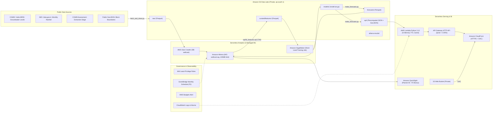

# WellCast: System Architecture & Data Specification

This document specifies the exact AWS cloud architecture, Amazon S3 data lake directory layout, canonical data dictionary, block identifier rules, Athena DDL/SQL feature engineering pipelines, and anti-leakage verification checks for Phases 1, 2, and 4.

---

## 1. End-to-End AWS Architecture



*(Note: Diagram uses standard Mermaid syntax; export a clean high-resolution PNG to `Docs/architecture.png` in Phase 9 for the README and Build Summary PDF.)*

### Architectural Design Principles
1. **Zero Idle Compute:** No EC2 servers, no RDS databases, no NAT Gateways, and no always-on SageMaker endpoints.
2. **Precompute-First Serving:** All 4 rainfall scenarios (`100%`, `90%`, `80%`, `70%`) are batch-scored offline and materialized as lightweight JSON objects under `s3://<data-bucket>/api/`. Lambda serves them in <150 ms without triggering paid Athena scans on every user click.
3. **Columnar Efficiency:** All analytics layers (`raw/`, `curated/`, `forecasts/`) are stored in **Apache Parquet (Snappy compression)** to minimize Athena scan volume and storage footprint.
4. **Private-by-Default Storage:** Both the Data Lake S3 bucket and the Static Web S3 bucket enforce `Block Public Access = ON`. Web content is served solely through CloudFront Origin Access Control (OAC).

---

## 2. Amazon S3 Storage Layout

### Bucket 1: Data Lake (`s3://wellcast-data-<account-id>-ap-south-1/`)
```text
s3://wellcast-data-<account-id>-ap-south-1/
├── raw/
│   ├── block/
│   │   └── blocks.parquet                        # Master block metadata & coordinates
│   ├── rainfall_monthly/
│   │   └── rainfall_monthly.parquet              # Monthly rainfall + departure
│   └── water_level/
│       └── water_level.parquet                   # Cleaned block-season groundwater levels
├── curated/
│   ├── features/
│   │   └── *.parquet                             # Athena CTAS output (wellcast.features)
│   ├── ml_train/
│   │   └── train_features.parquet                # Rows where target_depth_next IS NOT NULL
│   └── ml_inference/
│       └── latest_features.parquet               # Latest season snapshot for next-season scoring
├── models/
│   └── wellcast-xgb-<timestamp>/output/
│       └── model.tar.gz                          # SageMaker output (p50, p10, p90 + metadata.json)
├── forecasts/
│   └── season=2027-pre-monsoon/
│       └── forecasts.parquet                     # All 4 scenarios x all blocks (Athena + QuickSight)
├── api/
│   ├── meta.json                                 # Generation timestamp, model version, MAE metrics
│   ├── blocks.json                               # Lightweight list of all blocks + normal risk_class
│   ├── rankings/
│   │   └── MH.json                               # Ranked at-risk blocks (sorted worst-first)
│   ├── forecasts/
│   │   ├── normal/<block_id>.json                # 100% rainfall scenario per block
│   │   ├── minus10/<block_id>.json               # 90% rainfall scenario per block
│   │   ├── minus20/<block_id>.json               # 80% rainfall scenario per block
│   │   └── minus30/<block_id>.json               # 70% rainfall scenario per block
│   ├── history/
│   │   └── <block_id>.json                       # Full historical water levels + rainfall array
│   └── geojson/
│       └── MH_blocks.geojson                     # Simplified polygons keyed by block_id
└── athena-results/                               # Athena workgroup query outputs (7-day lifecycle delete)
```

### Bucket 2: Frontend Static Hosting (`s3://wellcast-web-<account-id>-ap-south-1/`)
```text
s3://wellcast-web-<account-id>-ap-south-1/
├── index.html                                    # Cache-Control: no-cache
├── favicon.ico
└── assets/                                       # Vite hashed JS/CSS bundles (Cache-Control: immutable)
```

---

## 3. Canonical Naming & Identifier Standard

Spelling inconsistencies across Indian government datasets are the #1 source of broken joins. Every ingestion script **must** enforce the following normalization pipeline:

### 3.1 Text Normalization Function (`normalize_name`)
1. Convert to UTF-8 NFKC, strip leading/trailing whitespace, collapse internal multiple spaces to single space.
2. Convert to `UPPERCASE`.
3. Remove punctuation (`'.'`, `','`, `'-'`, `'/'`, parenthetical suffixes like `(RURAL)` or `(URBAN)` unless needed to disambiguate).
4. Apply deterministic alias lookup from `data/scripts/name_aliases.json`, e.g.:
   ```json
   {
     "districts": {
       "AURANGABAD": "CHHATRAPATI SAMBHAJINAGAR",
       "OSMANABAD": "DHARASHIV",
       "AHMADNAGAR": "AHILYANAGAR",
       "BULDANA": "BULDHANA",
       "GONDIA": "GONDIYA",
       "RAIGARH": "RAIGAD"
     },
     "blocks": {
       "BARAMATI TALUKA": "BARAMATI",
       "SHIRUR (GHODNADI)": "SHIRUR"
     }
   }
   ```

### 3.2 Canonical `block_id` Format
```text
<STATE_CODE_2>-<DISTRICT_CODE_3>-<ZERO_PADDED_SEQ_3>
Example: MH-PUN-012  (Maharashtra, Pune district, block #12 sorted alphabetically)
```
- Generated deterministically from sorted unique `(state_norm, district_norm, block_norm)` in `blocks.parquet`.
- If falling back to **District granularity (`D-02`)**, use `<STATE_CODE_2>-<DISTRICT_CODE_3>-000` (e.g., `MH-PUN-000`) so all downstream SQL, ML, API, and UI schemas remain 100% compatible without code rewrites.

---

## 4. Detailed Data Dictionary & Parquet Schemas

### Table 1: `wellcast.block` (`s3://<bucket>/raw/block/`)
| Column | Athena / Parquet Type | Nullable | Unit / Format | Description & Constraints |
|---|---|---|---|---|
| `block_id` | `STRING` | No | `MH-PUN-012` | Primary key |
| `state_code` | `STRING` | No | `MH` | 2-letter ISO/census state code |
| `state` | `STRING` | No | Title Case | Display state name (e.g., `Maharashtra`) |
| `district` | `STRING` | No | Title Case | Standardized district name |
| `block_name` | `STRING` | No | Title Case | Standardized block/taluka name |
| `extraction_stage` | `STRING` | No | Enum | `Safe`, `Semi-Critical`, `Critical`, `Over-Exploited`, `Saline`, `Unknown` |
| `extraction_stage_code` | `INT` | No | `0`–`4` (`-1` unknown) | Ordinal encoding: Safe=0, Semi-Critical=1, Critical=2, Over-Exploited=3 |
| `lat` | `DOUBLE` | Yes | Decimal deg | Block centroid latitude (`15.0` to `23.0` for MH) |
| `lon` | `DOUBLE` | Yes | Decimal deg | Block centroid longitude (`72.0` to `81.5` for MH) |
| `granularity` | `STRING` | No | Enum | `"block"` or `"district"` |

### Table 2: `wellcast.rainfall_monthly` (`s3://<bucket>/raw/rainfall_monthly/`)
| Column | Athena / Parquet Type | Nullable | Unit / Format | Description & Constraints |
|---|---|---|---|---|
| `block_id` | `STRING` | No | FK -> `block` | Block identifier |
| `month` | `DATE` | No | `YYYY-MM-01` | First day of calendar month (PK with `block_id`) |
| `rainfall_mm` | `DOUBLE` | No | millimetres (`>= 0`) | Observed monthly rainfall |
| `normal_rainfall_mm` | `DOUBLE` | Yes | millimetres (`>= 0`) | Long-term monthly normal (IMD normal or multi-year historical mean) |
| `departure_from_normal_pct` | `DOUBLE` | Yes | percent | `((rainfall_mm - normal_rainfall_mm) / NULLIF(normal_rainfall_mm, 0)) * 100` |
| `rainfall_source_level` | `STRING` | No | Enum | `"block"`, `"gridded"`, or `"district_mapped"` |
| `is_imputed` | `BOOLEAN` | No | `true`/`false` | Whether this monthly rainfall value was interpolated |

### Table 3: `wellcast.water_level` (`s3://<bucket>/raw/water_level/`)
| Column | Athena / Parquet Type | Nullable | Unit / Format | Description & Constraints |
|---|---|---|---|---|
| `block_id` | `STRING` | No | FK -> `block` | Block identifier |
| `obs_date` | `DATE` | No | `YYYY-MM-01` | Canonical observation anchor date (`YYYY-05-01` pre-monsoon, `YYYY-11-01` post-monsoon) |
| `year` | `INT` | No | `YYYY` | Calendar year of observation |
| `season` | `STRING` | No | Enum | `"pre-monsoon"` or `"post-monsoon"` |
| `season_code` | `INT` | No | `0` or `1` | `0` = pre-monsoon (dry), `1` = post-monsoon (recharged) |
| `depth_mbgl` | `DOUBLE` | No | metres below ground (`>= 0`) | **Median** groundwater depth across block wells. **Higher value = deeper water table = worse depletion.** |
| `well_count` | `INT` | No | integer (`>= 1`) | Number of valid monitoring wells aggregated |
| `is_imputed` | `BOOLEAN` | No | `true`/`false` | `false` for authentic observations; `true` only if flagged gap fill |

### Table 4: `wellcast.features` (`s3://<bucket>/curated/features/`)
One row per `(block_id, obs_date)` representing the state of the aquifer at time `t` used to predict `t+1`.

| Column | Type | Role | Description |
|---|---|---|---|
| `block_id`, `obs_date`, `year`, `season` | Keys | ID / Split | Identifiers & temporal split column (excluded from model feature matrix `X`) |
| `depth_mbgl` | `DOUBLE` | Feature | Current season groundwater depth (`mbgl`) |
| `prev_depth_mbgl` | `DOUBLE` | Feature | Previous season (`t-1`) depth |
| `prev_change_mbgl` | `DOUBLE` | Feature | `depth_mbgl(t) - depth_mbgl(t-1)` (positive = deepening/depleting) |
| `same_season_last_year_depth` | `DOUBLE` | Feature + Baseline | `depth_mbgl(t-2)` (same season 1 year ago; also serves as Seasonal Naive predictor for `t+1` via `t-1` shift — see `ML_SPEC.md`) |
| `yoy_change_mbgl` | `DOUBLE` | Feature | `depth_mbgl(t) - depth_mbgl(t-2)` (year-over-year change) |
| `depth_trend_5yr` | `DOUBLE` | Feature | Avg annual change over trailing up to 5 years (`mbgl/year`, positive = long-term depletion) |
| `rain_3m_mm` | `DOUBLE` | Feature | Cumulative rainfall over `[obs_date - 2m, obs_date]` |
| `rain_6m_mm` | `DOUBLE` | Feature | Cumulative rainfall over `[obs_date - 5m, obs_date]` |
| `rain_12m_mm` | `DOUBLE` | Feature | Cumulative rainfall over `[obs_date - 11m, obs_date]` |
| `rain_6m_normal_mm` | `DOUBLE` | Reference | Normal cumulative 6-month rainfall for scenario perturbation |
| `rain_departure_6m_pct` | `DOUBLE` | Feature | 6-month cumulative departure from normal (%) |
| `extraction_stage_code` | `INT` | Feature | CGWB extraction stage (`0`–`3`, `-1` unknown) |
| `season_code` | `INT` | Feature | `0` (pre-monsoon) or `1` (post-monsoon) |
| `well_count` | `INT` | Metadata | Monitoring well count for data confidence badge |
| `target_obs_date` | `DATE` | Metadata | Date of next season `t+1` (NULL for latest season inference rows) |
| `target_depth_next` | `DOUBLE` | **Target (`y`)** | Ground-truth `depth_mbgl` at `t+1` (`NULL` for latest season rows) |
| `baseline_pred_next` | `DOUBLE` | Benchmark | `LAG(depth_mbgl, 1)` = depth from the same season 1 year prior to `target_obs_date` (strictly known at time `t`) |

### Table 5: `wellcast.forecasts` (`s3://<bucket>/forecasts/`)
| Column | Type | Description |
|---|---|---|
| `block_id` | `STRING` | Block identifier |
| `state`, `district`, `block_name` | `STRING` | Display names for QuickSight & Athena queries |
| `scenario` | `STRING` | `"normal"`, `"minus10"`, `"minus20"`, `"minus30"` |
| `rainfall_pct_of_normal` | `INT` | `100`, `90`, `80`, or `70` |
| `forecast_season` | `STRING` | e.g., `"2027-pre-monsoon"` |
| `current_depth_mbgl` | `DOUBLE` | Latest observed groundwater depth |
| `predicted_depth_mbgl` | `DOUBLE` | Point forecast (`P50` / XGBoost main prediction) |
| `lower_bound` | `DOUBLE` | 10th percentile depth (`P10`, shallower/better bound) |
| `upper_bound` | `DOUBLE` | 90th percentile depth (`P90`, deeper/worse bound) |
| `predicted_yoy_change_mbgl` | `DOUBLE` | `predicted_depth_mbgl - same_season_prev_year_depth` |
| `risk_class` | `STRING` | `"Safe"`, `"Watch"`, `"Critical"`, or `"Insufficient Data"` |
| `risk_score` | `DOUBLE` | Continuous `0`–`100` stress index used for deterministic planner ranking |
| `model_version` | `STRING` | e.g., `"xgb-v1-sagemaker-20261126"` |
| `generated_at` | `TIMESTAMP` | UTC generation timestamp |

---

## 5. Athena SQL Blueprints

### 5.1 `sql/01_create_tables.sql` (Backup Manual DDL Alongside Glue Crawler)
```sql
CREATE DATABASE IF NOT EXISTS wellcast;

CREATE EXTERNAL TABLE IF NOT EXISTS wellcast.block (
  block_id              STRING,
  state_code            STRING,
  state                 STRING,
  district              STRING,
  block_name            STRING,
  extraction_stage      STRING,
  extraction_stage_code INT,
  lat                   DOUBLE,
  lon                   DOUBLE,
  granularity           STRING
)
STORED AS PARQUET
LOCATION 's3://<DATA_BUCKET>/raw/block/';

CREATE EXTERNAL TABLE IF NOT EXISTS wellcast.rainfall_monthly (
  block_id                  STRING,
  month                     DATE,
  rainfall_mm               DOUBLE,
  normal_rainfall_mm        DOUBLE,
  departure_from_normal_pct DOUBLE,
  rainfall_source_level     STRING,
  is_imputed                BOOLEAN
)
STORED AS PARQUET
LOCATION 's3://<DATA_BUCKET>/raw/rainfall_monthly/';

CREATE EXTERNAL TABLE IF NOT EXISTS wellcast.water_level (
  block_id    STRING,
  obs_date    DATE,
  year        INT,
  season      STRING,
  season_code INT,
  depth_mbgl  DOUBLE,
  well_count  INT,
  is_imputed  BOOLEAN
)
STORED AS PARQUET
LOCATION 's3://<DATA_BUCKET>/raw/water_level/';
```

### 5.2 `sql/02_features.sql` (Zero-Leakage Feature Engineering CTAS)
> **Critical Anti-Leakage Principle:** Every feature window ends at `CURRENT ROW` (`obs_date`, time `t`). Only `target_obs_date` and `target_depth_next` look forward using `LEAD(..., 1)`. Note that for a semi-annual series (`pre-monsoon`, `post-monsoon`), when standing at time `t` (e.g., `2025-11-01` post-monsoon) predicting `t+1` (`2026-05-01` pre-monsoon), the **Seasonal Naive** predictor is `LAG(depth_mbgl, 1)` = `2025-05-01` pre-monsoon (the exact same season one year earlier!).

```sql
DROP TABLE IF EXISTS wellcast.features;

CREATE TABLE wellcast.features
WITH (
  format = 'PARQUET',
  parquet_compression = 'SNAPPY',
  external_location = 's3://<DATA_BUCKET>/curated/features/'
) AS
WITH rain_rolling AS (
  SELECT
    block_id,
    month,
    SUM(rainfall_mm) OVER (
      PARTITION BY block_id ORDER BY month
      ROWS BETWEEN 2 PRECEDING AND CURRENT ROW
    ) AS rain_3m_mm,
    SUM(rainfall_mm) OVER (
      PARTITION BY block_id ORDER BY month
      ROWS BETWEEN 5 PRECEDING AND CURRENT ROW
    ) AS rain_6m_mm,
    SUM(rainfall_mm) OVER (
      PARTITION BY block_id ORDER BY month
      ROWS BETWEEN 11 PRECEDING AND CURRENT ROW
    ) AS rain_12m_mm,
    SUM(normal_rainfall_mm) OVER (
      PARTITION BY block_id ORDER BY month
      ROWS BETWEEN 5 PRECEDING AND CURRENT ROW
    ) AS rain_6m_normal_mm,
    COUNT(rainfall_mm) OVER (
      PARTITION BY block_id ORDER BY month
      ROWS BETWEEN 5 PRECEDING AND CURRENT ROW
    ) AS rain_6m_obs_count
  FROM wellcast.rainfall_monthly
),
wl_lags AS (
  SELECT
    w.block_id,
    w.obs_date,
    w.year,
    w.season,
    w.season_code,
    w.depth_mbgl,
    w.well_count,
    w.is_imputed,
    LAG(w.depth_mbgl, 1) OVER (PARTITION BY w.block_id ORDER BY w.obs_date) AS prev_depth_mbgl,
    LAG(w.depth_mbgl, 2) OVER (PARTITION BY w.block_id ORDER BY w.obs_date) AS same_season_last_year_depth,
    LAG(w.depth_mbgl, 10) OVER (PARTITION BY w.block_id ORDER BY w.obs_date) AS depth_5yr_ago,
    LAG(w.obs_date, 10) OVER (PARTITION BY w.block_id ORDER BY w.obs_date) AS date_5yr_ago,
    LEAD(w.obs_date, 1) OVER (PARTITION BY w.block_id ORDER BY w.obs_date) AS target_obs_date,
    LEAD(w.depth_mbgl, 1) OVER (PARTITION BY w.block_id ORDER BY w.obs_date) AS target_depth_next
  FROM wellcast.water_level w
)
SELECT
  w.block_id,
  w.obs_date,
  w.year,
  w.season,
  w.season_code,
  w.depth_mbgl,
  w.prev_depth_mbgl,
  w.depth_mbgl - w.prev_depth_mbgl AS prev_change_mbgl,
  w.same_season_last_year_depth,
  w.depth_mbgl - w.same_season_last_year_depth AS yoy_change_mbgl,
  CASE
    WHEN w.depth_5yr_ago IS NOT NULL
         AND date_diff('day', w.date_5yr_ago, w.obs_date) > 300
    THEN (w.depth_mbgl - w.depth_5yr_ago) / (date_diff('day', w.date_5yr_ago, w.obs_date) / 365.25)
    ELSE (w.depth_mbgl - w.same_season_last_year_depth)
  END AS depth_trend_5yr,
  r.rain_3m_mm,
  r.rain_6m_mm,
  r.rain_12m_mm,
  r.rain_6m_normal_mm,
  CASE
    WHEN r.rain_6m_normal_mm > 0
    THEN ((r.rain_6m_mm - r.rain_6m_normal_mm) / r.rain_6m_normal_mm) * 100.0
    ELSE NULL
  END AS rain_departure_6m_pct,
  b.extraction_stage_code,
  w.well_count,
  w.is_imputed,
  w.prev_depth_mbgl AS baseline_pred_next,
  w.target_obs_date,
  w.target_depth_next
FROM wl_lags w
JOIN wellcast.block b
  ON w.block_id = b.block_id
LEFT JOIN rain_rolling r
  ON w.block_id = r.block_id
 AND date_trunc('month', w.obs_date) = r.month
WHERE r.rain_6m_obs_count = 6;
```

> **Note on Missing Seasons:** In Phase 2 validation (`T2.2`), verify `date_diff('month', obs_date, target_obs_date)` is within `5–7` months (for semi-annual cadence). Rows where `target_obs_date` skips an entire year (> 8 months gap) must be filtered out of `ml_train/` so the model never mixes 6-month horizons with 18-month horizons!

### 5.3 `sql/03_serving_views.sql` (Planner & QuickSight Views)
```sql
CREATE OR REPLACE VIEW wellcast.v_top_at_risk_normal AS
SELECT
  f.block_id,
  f.state,
  f.district,
  f.block_name,
  b.extraction_stage,
  f.forecast_season,
  f.current_depth_mbgl,
  f.predicted_depth_mbgl,
  f.lower_bound,
  f.upper_bound,
  f.predicted_yoy_change_mbgl,
  f.risk_class,
  f.risk_score
FROM wellcast.forecasts f
JOIN wellcast.block b ON f.block_id = b.block_id
WHERE f.scenario = 'normal'
  AND f.risk_class <> 'Insufficient Data'
ORDER BY f.risk_score DESC;

CREATE OR REPLACE VIEW wellcast.v_district_risk_summary AS
SELECT
  state,
  district,
  scenario,
  COUNT(*) AS total_blocks,
  SUM(CASE WHEN risk_class = 'Critical' THEN 1 ELSE 0 END) AS critical_blocks,
  SUM(CASE WHEN risk_class = 'Watch' THEN 1 ELSE 0 END) AS watch_blocks,
  SUM(CASE WHEN risk_class = 'Safe' THEN 1 ELSE 0 END) AS safe_blocks,
  ROUND(AVG(predicted_depth_mbgl), 2) AS avg_predicted_depth_mbgl
FROM wellcast.forecasts
GROUP BY state, district, scenario;
```

---

## 6. Mandatory Anti-Leakage & Data Integrity Verification Queries

Run these queries in Athena before exporting `ml_train/`:

```sql
-- 1. Verify zero duplicate (block_id, obs_date) keys
SELECT block_id, obs_date, COUNT(*) AS cnt
FROM wellcast.features
GROUP BY 1, 2
HAVING COUNT(*) > 1;
-- Expected: 0 rows

-- 2. Verify strictly positive forward horizon (no backward or skipped horizons in training set)
SELECT
  MIN(date_diff('month', obs_date, target_obs_date)) AS min_gap_months,
  MAX(date_diff('month', obs_date, target_obs_date)) AS max_gap_months,
  COUNT(*) AS total_training_rows
FROM wellcast.features
WHERE target_depth_next IS NOT NULL;
-- Expected: min_gap_months >= 5, max_gap_months <= 7 (filter gaps > 8 before ML export)

-- 3. Check null percentages across all features
SELECT
  COUNT(*) AS total_rows,
  SUM(CASE WHEN depth_mbgl IS NULL THEN 1 ELSE 0 END) AS null_depth,
  SUM(CASE WHEN rain_6m_mm IS NULL THEN 1 ELSE 0 END) AS null_rain6m,
  SUM(CASE WHEN prev_change_mbgl IS NULL THEN 1 ELSE 0 END) AS null_prev_chg,
  SUM(CASE WHEN target_depth_next IS NULL THEN 1 ELSE 0 END) AS null_target_inference_rows
FROM wellcast.features;
```
