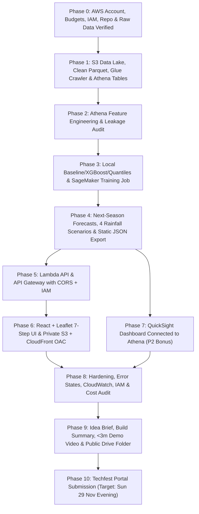

# WellCast: Detailed Execution Plan

> **Sprint Window:** Tue 24 Nov 2026 to Mon 30 Nov 2026 (Target Submit: **Sun 29 Nov 2026 evening IST**; Hard Deadline: **Mon 30 Nov 2026, 11:59 PM IST**)  
> **Demo Day:** Thu 17 Dec 2026 at IIT Bombay (3 min live demo + 2 min judge Q&A)  
> **Source Plan:** [`IMPLEMENTATION_PLAN.md`](./IMPLEMENTATION_PLAN.md)

This document converts the high-level implementation plan into an actionable, task-level engineering runbook with explicit Task IDs, dependencies, timeboxes, decision gates, verification commands, fallback triggers, and Definition of Done (DoD).

---

## 1. Executive Mission & Priority Tiers

If time gets compressed (especially if working solo or hitting data cleanup delays), execute strictly in priority order:

| Priority Tier | Scope | Rule |
|---|---|---|
| **P0 (Non-Negotiable Core)** | Real multi-year groundwater + rainfall data -> S3 + Glue + Athena -> Time-split model (Baseline + XGBoost) -> SageMaker training job -> Precomputed JSON -> Lambda + API Gateway -> React + Leaflet Map + Forecast Chart on CloudFront -> Docs + <3 min Video -> Submit | Must be 100% live, verified, and bug-free by Day 6 noon |
| **P1 (High-Impact Differentiators)** | Quantile P10/P90 confidence bands, Precomputed rainfall scenario slider (100/90/80/70%), Planner ranked at-risk view in React, Plain-language crop/water advice, Mobile responsiveness, Data limitations banner | Build directly on top of P0 on Days 4–5 |
| **P2 (Bonus / Cut-First if Behind)** | Hindi + Marathi i18n toggle (EN/HI/MR), Amazon QuickSight planner dashboard + recorded backup, EventBridge automated monthly schedule | Only execute after P0 and P1 pass exit gates; cut QuickSight first if behind schedule |

---

## 2. Locked Decisions Register (Lock on Day 1 — Tue 24 Nov)

Every item below must be finalized and recorded as `LOCKED` before Phase 1 starts.

| ID | Decision Area | Recommended Default | Status | Fallback / Escape Hatch | Owner |
|---|---|---|---|---|---|
| `D-01` | Target State | **Maharashtra** (rich CGWB/GSDA & IMD coverage, natural IIT Bombay relevance) | `LOCKED` | Verified: 756k raw well readings & 356 blocks across 36 districts | Data/ML |
| `D-02` | Spatial Granularity | **Block (Taluka) level** | `LOCKED` | Verified: 100% well-to-block match across 356 canonical blocks | Data/ML |
| `D-03` | AWS Region | **`ap-south-1` (Mumbai)** | `LOCKED` | Do not split services across regions (avoid cross-region latency/egress) | Backend/AWS |
| `D-04` | Serving Architecture | **Precomputed static JSON in S3 served via Lambda + API Gateway** | `LOCKED` | Fallback to direct Athena queries only if JSON export fails (slower, costs per query) | Backend/AWS |
| `D-05` | ML Modelling Stack | **Seasonal Naive baseline + Residual Monotone XGBoost + Quantile P10/P90** | `LOCKED` | Verified: Beats baseline on 2025 holdout (`0.8703 m` vs `0.8727 m` MAE; `91.9%` coverage) | Data/ML |
| `D-06` | Frontend Stack | **React (Vite) + Leaflet + Recharts** | `LOCKED` | Verified: 455.7 KB simplified `MH_blocks.geojson` + split vendor chunks | Frontend |
| `D-07` | Naming & Bucket Convention | `wellcast-data-<acct>-ap-south-1` & `wellcast-web-<acct>-ap-south-1` | `LOCKED` | Template wired into `.env.example`, `infra/deploy.ps1`, and IAM policies | Backend/AWS |
| `D-08` | Team Leader & Submission Owner | Named Team Leader with verified Techfest Team ID & AWS Builder Center alias | `PENDING` | Must be locked by user before portal submission | Team Lead |

---

## 3. End-to-End Critical Path & Dependencies

**Parallelizable Tracks (if working as a team):**
- **Day 2–3:** While Data/ML executes Phases 1–3, Backend/AWS can scaffold `backend/`, IAM policies, S3 buckets, and API Gateway using sample mock JSON contracts defined in [`API_AND_FRONTEND_SPEC.md`](./API_AND_FRONTEND_SPEC.md).
- **Day 3–4:** Frontend can scaffold the React + Vite + Leaflet UI against local mock JSON matching the exact schema in `API_AND_FRONTEND_SPEC.md`, then swap in the live API Gateway URL on Day 4 afternoon.
- **Day 4–5:** Storytelling/Docs can finalize `idea-brief.md`, `build-summary.md`, architecture PNG diagrams, and the demo script while frontend deploys.

---

## 4. Detailed Phase-by-Phase Task Breakdown

### Phase 0: Foundation & Data Acquisition
**Schedule:** Day 1 — Tue 24 Nov 2026 (Morning to Night)  
**Target Exit Gate (`GATE-0`):** Verified multi-year groundwater + rainfall files open cleanly locally; AWS account has Root MFA, IAM user, and Budget alert active; Repo scaffolded.

| Task ID | Task Description | Priority | Owner | Depends On | Concrete Deliverables / Artifacts | Verification Check |
|---|---|---|---|---|---|---|
| `T0.1` | Create AWS Builder Center profile, record alias, initiate student verification (must complete by 27 Nov) | `P0` | Team Lead | — | Alias recorded in `README.md` & `EXECUTION_PLAN.md` | Verification email/status screenshot saved |
| `T0.2` | Register team on `techfest.org`, record Team ID, lock Team Leader (`D-08`) | `P0` | Team Lead | — | Team ID recorded in private notes & submission checklist | Portal registration confirmed |
| `T0.3` | Provision AWS account (`ap-south-1`), enable **Root MFA**, create non-root IAM Admin/Dev user, configure AWS CLI profile | `P0` | Backend/AWS | — | `~/.aws/config` profile `wellcast` (never committed) | `aws sts get-caller-identity` returns IAM user ARN, not root |
| `T0.4` | Set **AWS Budgets** zero-spend / low-spend alerts (\$1, \$5, \$10 thresholds) with email notifications | `P0` | Backend/AWS | `T0.3` | Active budget in AWS Billing console | Confirmation email received |
| `T0.5` | Scaffold repository folders (`data/`, `sql/`, `ml/`, `backend/`, `frontend/`, `infra/`), `.gitignore`, and `LICENSE` | `P0` | Backend/AWS | — | Full directory skeleton + `.gitignore` blocking `.env`, AWS keys, raw huge files, `node_modules` | `git status` clean; folder layout matches README |
| `T0.6` | Source & download raw public datasets for target state (`D-01`): (a) CGWB / India-WRIS groundwater levels (5+ yrs pre/post-monsoon), (b) IMD / data.gov.in monthly rainfall, (c) CGWB block extraction stage report, (d) Administrative boundary GeoJSON | `P0` | Data/ML | `T0.5` | Raw files stored locally in `data/raw_local/` (gitignored) + tiny sample in `data/sample/` | Python inspection script opens every file, prints row count, year span, unique blocks/districts |
| `T0.7` | Execute **Data Coverage Audit** and lock `D-01` (State) and `D-02` (Block vs District granularity) | `P0` | Data/ML | `T0.6` | Audit notes logged in `ai_logs/` and `DATA_SOURCES.md` | >= 5 years of overlapping groundwater + rainfall confirmed |

**Phase 0 Fallback Triggers:**
- Rainfall only available at district level -> Lock district-to-block rainfall mapping in `DATA_SOURCES.md` and `ARCHITECTURE_AND_DATA_SPEC.md`.
- Monitoring wells sparse at block level (<50% blocks have >=4 years) -> Aggregate wells per block first; if still too thin, switch `D-02` to district level and state openly everywhere.
- Target state portal is down or missing multi-year files -> Switch `D-01` to backup state by Day 1 8:00 PM IST. **Never fabricate data.**

---

### Phase 1: Data Cleaning & S3 Data Lake
**Schedule:** Day 2 — Wed 25 Nov 2026 (Morning to Afternoon)  
**Target Exit Gate (`GATE-1`):** All raw tables registered in Glue Data Catalog and queryable via Athena; block-month join returns expected row counts with zero broken keys.

| Task ID | Task Description | Priority | Owner | Depends On | Concrete Deliverables / Artifacts | Verification Check |
|---|---|---|---|---|---|---|
| `T1.1` | Create S3 Data Lake bucket (`wellcast-data-<acct>-ap-south-1`) with private access and prefixes: `raw/`, `curated/`, `forecasts/`, `api/`, `athena-results/`, `models/` | `P0` | Backend/AWS | `T0.3`, `T0.4` | Bucket created with Block Public Access ON & SSE-S3 encryption | `aws s3 ls s3://<bucket>/` succeeds |
| `T1.2` | Configure Athena Workgroup `wellcast-wg` with output location `s3://<bucket>/athena-results/` and per-query data scan cutoff (100 MB) | `P0` | Backend/AWS | `T1.1` | Workgroup active in `ap-south-1` | Test query `SELECT 1` succeeds and writes to `athena-results/` |
| `T1.3` | Build `data/scripts/fetch_and_clean.py`: normalize state/district/block names (uppercase, trim, alias mapping dict), generate canonical `block_id`, standardize dates (`YYYY-MM-DD`, season enum), drop impossible values (`depth_mbgl < 0` or `> 300`, `rainfall_mm < 0`), flag imputed/missing rows | `P0` | Data/ML | `T0.7` | `data/scripts/fetch_and_clean.py` + `data/scripts/name_aliases.json` + clean Parquet files (`block/`, `rainfall_monthly/`, `water_level/`) | Unit assertions pass: 0 duplicate PKs, >=90% join match rate between water level & rainfall |
| `T1.4` | Populate `DATA_SOURCES.md` with exact dataset URLs, agency names, retrieval dates, licence terms, known gaps, and geographic resolution | `P0` | Data/ML | `T1.3` | Completed `DATA_SOURCES.md` | Every dataset in `raw/` has an entry with URL + licence |
| `T1.5` | Build `data/scripts/upload_to_s3.sh` (or `.ps1`) and upload cleaned Parquet files to `s3://<bucket>/raw/` | `P0` | Data/ML | `T1.1`, `T1.3` | Parquet files in `raw/block/`, `raw/rainfall_monthly/`, `raw/water_level/` | `aws s3 ls --recursive s3://<bucket>/raw/` shows expected Parquet files |
| `T1.6` | Create Glue Database `wellcast`, IAM role `wellcast-glue-crawler-role`, and run Glue Crawler over `s3://<bucket>/raw/` (plus write backup DDL `sql/01_create_tables.sql`) | `P0` | Backend/AWS | `T1.5` | Glue tables `block`, `rainfall_monthly`, `water_level` + `sql/01_create_tables.sql` | Athena `SELECT COUNT(*) FROM wellcast.water_level` & join query return valid rows |

---

### Phase 2: Feature Engineering in Athena
**Schedule:** Day 2 Evening (Wed 25 Nov) to Day 3 Morning (Thu 26 Nov)  
**Target Exit Gate (`GATE-2`):** `wellcast.features` Parquet table exists in `curated/features/`, contains clean seasonal target, and passes strict zero-data-leakage audit.

| Task ID | Task Description | Priority | Owner | Depends On | Concrete Deliverables / Artifacts | Verification Check |
|---|---|---|---|---|---|---|
| `T2.1` | Author `sql/02_features.sql` CTAS query joining `water_level`, `rainfall_monthly`, and `block` to compute per-block-per-season features: `rain_3m`, `rain_6m`, `rain_12m`, `departure_from_normal_pct`, `prev_depth_mbgl`, `prev_change_mbgl`, `depth_trend_5yr`, `extraction_stage_code`, `season_code`, and target `target_depth_next` (using `LEAD` strictly ordered by `obs_date`) | `P0` | Data/ML | `T1.6` | `sql/02_features.sql` + `s3://<bucket>/curated/features/` Parquet output | Athena CTAS succeeds; table `wellcast.features` queryable |
| `T2.2` | Run SQL Data Quality & Anti-Leakage Audit: check row counts, null rates per column, min/max bounds, manually inspect 5 random blocks across all years to confirm no future rainfall or future depth leaks into `X` | `P0` | Data/ML | `T2.1` | Audit query results saved in `ai_logs/` | Zero future leakage; target nulls exist only on the latest observed season (inference rows) |
| `T2.3` | Export training dataset (`target_depth_next IS NOT NULL`) and latest inference feature snapshot (`target_depth_next IS NULL`) to `curated/ml_train/` and `curated/ml_inference/` (and local cache for fast dev) | `P0` | Data/ML | `T2.2` | Clean Parquet partitions ready for local ML & SageMaker | Local `pd.read_parquet()` loads cleanly with exact expected schema |

---

### Phase 3: Local ML Development & SageMaker Training
**Schedule:** Day 3 — Thu 26 Nov 2026 (Morning to Night)  
**Target Exit Gate (`GATE-3`):** Time-based evaluation table comparing Baseline vs XGBoost + Quantile P10/P90 coverage; 1 real AWS SageMaker training job completed; **zero billable SageMaker resources left running**.

| Task ID | Task Description | Priority | Owner | Depends On | Concrete Deliverables / Artifacts | Verification Check |
|---|---|---|---|---|---|---|
| `T3.1` | Set up `ml/requirements.txt` and `ml/evaluate.py` implementing strict **time-based train/validation/test split** (train on earlier years, test on most recent observed year; never random split) | `P0` | Data/ML | `T2.3` | `ml/requirements.txt`, `ml/evaluate.py` | Split prints exact date cutoff with zero temporal overlap |
| `T3.2` | Implement **Seasonal Naive Baseline** (`predicted = same season last year`) and compute holdout MAE, RMSE, and R2 | `P0` | Data/ML | `T3.1` | Logged baseline metrics in `ml/metrics.json` & `ai_logs/` | Reproducible MAE benchmark recorded |
| `T3.3` | Implement & tune **XGBoost Regressor** locally in `ml/train.py`; compare against baseline MAE overall and per extraction stage | `P0` | Data/ML | `T3.2` | `ml/train.py`, feature importance report, updated `ml/metrics.json` | XGBoost beats baseline MAE (or fallback to Baseline+Trend documented honestly) |
| `T3.4` | Train **Quantile XGBoost models (P10 and P90)** inside `ml/train.py` for uncertainty bounds; enforce `lower_bound <= predicted <= upper_bound` and verify empirical ~80% interval coverage on holdout | `P1` | Data/ML | `T3.3` | Saved `model_p50.json`, `model_p10.json`, `model_p90.json` | Coverage % and interval width sanity-checked |
| `T3.5` | Calibrate **Risk Classification Thresholds** (`Safe`, `Watch`, `Critical`) and cross-check confusion matrix against CGWB extraction stage categories | `P0` | Data/ML | `T3.3` | Risk classification function in `ml/risk_rules.py` | Sensible distribution (not 100% one class); aligns logically with Over-Exploited/Critical blocks |
| `T3.6` | Create least-privilege `wellcast-sagemaker-training-role` and run **one managed AWS SageMaker Training Job** (`ml.m5.large` or `ml.t3.medium`, script mode) executing `ml/train.py` reading from `s3://<bucket>/curated/ml_train/` and saving artifacts to `s3://<bucket>/models/` | `P0` | Data/ML + AWS | `T3.4`, `T3.5` | Completed SageMaker Training Job ARN + `model.tar.gz` in S3 + console screenshot for submission | Job status `Completed`; artifacts exist in `s3://<bucket>/models/` |
| `T3.7` | **Mandatory SageMaker Cost Cleanup:** Confirm zero running notebook instances, Studio apps, or hosted inference endpoints | `P0` | Backend/AWS | `T3.6` | CLI verification output logged in `ai_logs/` | `aws sagemaker list-endpoints` and `list-notebook-instances` both return empty |

---

### Phase 4: Forecasts, Precomputed Scenarios & Static JSON Export
**Schedule:** Day 4 Morning — Fri 27 Nov 2026  
**Target Exit Gate (`GATE-4`):** Athena `SELECT ... ORDER BY risk_score DESC LIMIT 10` returns sensible top at-risk blocks; all S3 `api/` JSON files uploaded and schema-validated.

| Task ID | Task Description | Priority | Owner | Depends On | Concrete Deliverables / Artifacts | Verification Check |
|---|---|---|---|---|---|---|
| `T4.1` | Build `ml/make_forecasts.py` to load the SageMaker-trained model artifacts and predict next-season groundwater depth + P10/P90 bounds + risk class for every block | `P0` | Data/ML | `T3.6` | Forecast DataFrame for baseline scenario (`normal` = 100% rainfall) | Zero NaNs; predicted depths within realistic physical range |
| `T4.2` | Generate **4 Precomputed Rainfall Scenarios** (`normal` 100%, `minus10` 90%, `minus20` 80%, `minus30` 70%) by perturbing rainfall features cleanly and re-scoring | `P1` | Data/ML | `T4.1` | Combined forecast dataset (`4 x N_blocks` rows) | Lower rainfall logically shifts predicted depth deeper or equal on aggregate |
| `T4.3` | Upload forecast Parquet to `s3://<bucket>/forecasts/`, register Athena table + serving views (`sql/03_serving_views.sql`) | `P0` | Data/ML | `T4.2` | `sql/03_serving_views.sql`, Athena table `wellcast.forecasts` | Athena top-10 at-risk query returns clean results |
| `T4.4` | Author plain-language risk advice strings for `Safe`, `Watch`, `Critical` in **English** (`P0`), plus **Hindi** and **Marathi** (`P2`) | `P1`/`P2` | Storytelling + Data | `T3.5` | Advice catalog embedded in JSON exporter & `frontend/src/i18n/` | Reviewed for clarity, farmer tone, and no medical/legal overclaims |
| `T4.5` | Export precomputed static JSON payloads to `s3://<bucket>/api/`: `blocks.json`, `rankings/<state>.json`, `forecasts/<scenario>/<block_id>.json`, `history/<block_id>.json`, and simplified GeoJSON boundary file | `P0` | Data/ML | `T4.2`, `T4.4` | All JSON files uploaded to `s3://<bucket>/api/` | JSON schema validator script checks 100% of exported files pass `API_AND_FRONTEND_SPEC.md` |

---

### Phase 5: Serverless Backend API (Lambda + API Gateway)
**Schedule:** Day 4 Afternoon — Fri 27 Nov 2026  
**Target Exit Gate (`GATE-5`):** Every API Gateway route returns valid JSON with proper CORS headers, warm-cache speed (<300 ms), and clean `404`/`400` error handling.

| Task ID | Task Description | Priority | Owner | Depends On | Concrete Deliverables / Artifacts | Verification Check |
|---|---|---|---|---|---|---|
| `T5.1` | Implement `backend/lambda_handler.py` (supporting all 5 routes: `/blocks`, `/blocks/{block_id}/forecast`, `/blocks/{block_id}/history`, `/rankings`, `/health`) reading from S3 `api/` with in-memory TTL cache + optional `backend/athena_client.py` fallback | `P0` | Backend/AWS | `T4.5` | `backend/lambda_handler.py`, `backend/athena_client.py`, `backend/requirements.txt` | Local pytest / unit harness passes all 5 routes + invalid block 404 + invalid scenario 400 |
| `T5.2` | Create least-privilege `wellcast-lambda-api-role` (read-only `s3:GetObject` on `s3://<bucket>/api/*` + CloudWatch Logs) and deploy Lambda function (Python 3.12, 256 MB RAM, 10s timeout) | `P0` | Backend/AWS | `T5.1` | Live AWS Lambda function in `ap-south-1` + `infra/iam-policies/lambda-api-policy.json` | Direct AWS CLI `lambda invoke` succeeds |
| `T5.3` | Provision **API Gateway HTTP API** (cheaper/faster than REST API) with all 5 routes, stage `prod`, throttling limits, and CORS enabled | `P0` | Backend/AWS | `T5.2` | Live Base URL `https://<api-id>.execute-api.ap-south-1.amazonaws.com/prod` | `curl` test suite passes for all 5 endpoints + CORS `OPTIONS` preflight |
| `T5.4` | Write `infra/deploy.sh` (or `deploy.ps1`) to automate Lambda zip packaging & update cleanly | `P1` | Backend/AWS | `T5.3` | Repeatable deploy script in `infra/` | Dry-run / redeploy succeeds cleanly |

---

### Phase 6: Frontend Web App & CloudFront Deployment
**Schedule:** Day 4 Evening (Fri 27 Nov) to Day 5 Afternoon (Sat 28 Nov)  
**Target Exit Gate (`GATE-6`):** Public `https://<id>.cloudfront.net` URL loads over HTTPS on desktop and mobile phones on a different network, showing real map, forecast chart, scenario slider, advice, and planner view.

Build strictly in the **7-step incremental order** so a working demo exists at every milestone:

| Task ID | Task Description | Priority | Owner | Depends On | Concrete Deliverables / Artifacts | Verification Check |
|---|---|---|---|---|---|---|
| `T6.1` | Initialize Vite + React app in `frontend/`, configure API base URL via `.env`, build **Step 1: Block Selector + Live Risk Badge** | `P0` | Frontend | `T5.3` (or mock) | Working local app hitting live `/blocks` & `/forecast` | Selecting a block updates risk badge from live API |
| `T6.2` | Build **Step 2: Interactive Leaflet Map** with color-coded blocks (`Safe` green, `Watch` amber, `Critical` red, `No Data` gray) + click-to-select & legend | `P0` | Frontend | `T6.1` | `src/components/MapView.jsx` | Clicking any map block opens its detail panel smoothly |
| `T6.3` | Build **Step 3: Forecast & History Chart** showing historical depth (`mbgl`), next-season predicted depth, and shaded P10–P90 confidence band | `P0`/`P1` | Frontend | `T6.1` | `src/components/ForecastChart.jsx` | Chart accurately displays inverted depth axis (deeper = lower) with clear labels |
| `T6.4` | Build **Step 4: Rainfall Scenario Slider** (`100% Normal`, `-10%`, `-20%`, `-30%`) fetching/switching precomputed scenarios smoothly | `P1` | Frontend | `T6.3` | `src/components/ScenarioSlider.jsx` | Dragging slider updates forecast depth, risk badge, and advice in <200 ms |
| `T6.5` | Build **Step 5: Plain-Language Advice Panel + Language Toggle** (`EN` / `HI` / `MR`) using `src/i18n/{en,hi,mr}.json` | `P1`/`P2` | Frontend | `T6.1`, `T4.4` | `src/components/AdvicePanel.jsx`, `src/i18n/*.json` | Switching languages updates UI labels and advice cleanly without broken layout |
| `T6.6` | Build **Step 6 & 7: Mobile Responsive Layout + Planner View** (ranked at-risk blocks table with district filter, CSV export, and risk summary cards) | `P1` | Frontend | `T6.2`–`T6.5` | `src/components/PlannerView.jsx`, responsive CSS | Tested at `375px` mobile viewport & desktop; zero horizontal overflow |
| `T6.7` | Deploy to **Private S3 bucket + CloudFront Distribution with Origin Access Control (OAC)**, default root object `index.html`, SPA custom error response (403/404 -> `/index.html`), tighten API Gateway CORS to CloudFront domain | `P0` | Backend/AWS + Frontend | `T6.6` | Live HTTPS `https://<id>.cloudfront.net` URL | Verified on mobile phone over cellular network (incognito) |

---

### Phase 7: Amazon QuickSight Planner Dashboard (P2 Bonus)
**Schedule:** Day 5 Evening — Sat 28 Nov 2026  
**Target Exit Gate (`GATE-7`):** QuickSight dashboard visualizes Athena `wellcast.forecasts` data; high-resolution screenshots and a 30-second screen capture saved in `Docs/assets/`.

| Task ID | Task Description | Priority | Owner | Depends On | Concrete Deliverables / Artifacts | Verification Check |
|---|---|---|---|---|---|---|
| `T7.1` | Check QuickSight free trial/pricing terms in `ap-south-1` and confirm whether access lasts past **17 Dec 2026**; abort/cut if unexpected upfront billing applies | `P2` | Backend/AWS | `T4.3` | Decision logged in `ai_logs/` | Zero unexpected subscription charge |
| `T7.2` | Connect QuickSight to Athena `wellcast.forecasts` + `wellcast.block`, build 3 visuals: (1) Top 20 At-Risk Blocks bar chart, (2) District Risk Distribution stacked bar, (3) Multi-year Depth Trend line | `P2` | Frontend / Data | `T7.1` | Published QuickSight Analysis/Dashboard | Visuals render real Athena numbers accurately |
| `T7.3` | Capture **HD screenshots + 30s screen recording immediately** and store in `Docs/assets/` as insurance in case trial expires before Demo Day | `P2` | Storytelling | `T7.2` | Images/clips backed up locally & in submission Drive | Media plays cleanly |

---

### Phase 8: Hardening, Security & Cost Audit
**Schedule:** Day 5 Night (Sat 28 Nov) to Day 6 Morning (Sun 29 Nov)  
**Target Exit Gate (`GATE-8`):** Zero secrets in repo, zero idle paid AWS resources, graceful UI error states, visible limitations disclaimer, CloudWatch logs & alarms verified.

| Task ID | Task Description | Priority | Owner | Depends On | Concrete Deliverables / Artifacts | Verification Check |
|---|---|---|---|---|---|---|
| `T8.1` | Add UI error/loading/empty states (missing block data notice, offline API banner, imputed-data badge) + visible **Data Sources & Limitations Footer/Modal** | `P0` | Frontend | `T6.7` | Updated React build redeployed & CloudFront invalidated | Simulated offline API displays friendly fallback UI |
| `T8.2` | Configure CloudWatch Log Group retention (14 days), structured JSON logging in Lambda, and 1 CloudWatch Alarm on Lambda Errors > 5 in 5 min | `P0` | Backend/AWS | `T5.2` | CloudWatch Alarm active | Test log line appears in CloudWatch Insights |
| `T8.3` | Perform **Full Security & Repo Hygiene Audit**: run secret scan across git history, verify IAM least privilege, confirm S3 Data Lake & Web buckets have Block Public Access ON, confirm API Gateway CORS matches CloudFront origin | `P0` | Backend/AWS | `T6.7` | Completed checklist in `TESTING_AND_QA_CHECKLIST.md` | Zero AWS keys/tokens in working tree or `git log` |
| `T8.4` | Perform **AWS Cost & Idle Resource Audit**: check Billing Cost Explorer, verify Budgets alert active, confirm 0 SageMaker notebooks/endpoints, 0 EC2/RDS/NAT, Athena scan limits enforced | `P0` | Backend/AWS | `T8.3` | Screenshot of Billing Dashboard & Budgets | Projected spend within free tier / credits |
| `T8.5` | (Optional `P2`) Configure EventBridge Scheduler monthly rule (disabled or dry-run documented) demonstrating automated seasonal refresh | `P2` | Backend/AWS | `T8.2` | EventBridge rule exported in `infra/` | Rule visible in AWS console & screenshot captured |

---

### Phase 9: Hackathon Submission Assets & Packaging
**Schedule:** Day 6 — Sun 29 Nov 2026 (Morning to Afternoon)  
**Target Exit Gate (`GATE-9`):** All 5 submission assets complete, GitHub repo public & spotless, Google Drive folder verified in an incognito browser window.

| Task ID | Task Description | Priority | Owner | Depends On | Concrete Deliverables / Artifacts | Verification Check |
|---|---|---|---|---|---|---|
| `T9.1` | Finalize [`Docs/idea-brief.md`](./idea-brief.md) and export clean PDF (`WellCast_Idea_Brief.pdf`) with real metrics, block counts, and screenshots | `P0` | Storytelling | `T8.4` | Finalized Markdown + PDF | Proofread; zero placeholder `<...>` strings left |
| `T9.2` | Finalize [`Docs/build-summary.md`](./build-summary.md) and export clean PDF (`WellCast_Build_Summary.pdf`) with AWS service table, architecture diagram, and model MAE table | `P0` | Storytelling | `T8.4` | Finalized Markdown + PDF | Every AWS service claimed is actually deployed |
| `T9.3` | Export clean `Docs/architecture.png` diagram and complete `README.md` (plug in Live CloudFront URL, Demo Video link, AWS Builder Center alias, team names, and sections 10–16) | `P0` | Storytelling + AWS | `T8.4` | Updated `README.md` + `Docs/architecture.png` | GitHub renders all Mermaid diagrams, images, and links cleanly |
| `T9.4` | Record & edit **Demo Video (< 3:00 strictly, target 2:45)** following the 6-part script in `IMPLEMENTATION_PLAN.md` (with clear audio, live mobile/desktop demo, real scenario slider, architecture slide) | `P0` | Storytelling | `T6.7`, `T9.3` | `WellCast_Demo_Video.mp4` (1080p, < 3:00) | Watched end-to-end by team; audio crisp; duration <= 2:55 |
| `T9.5` | Flip GitHub repository visibility to **Public** and verify fresh `git clone` works cleanly | `P0` | Team Lead | `T8.3`, `T9.3` | Public GitHub repo URL | Opened in incognito browser; zero secrets/broken links |
| `T9.6` | Assemble **Single Google Drive Submission Folder** containing: (1) Idea Brief PDF, (2) Build Summary PDF, (3) `LINKS.txt` / Doc with Prototype URL & GitHub Repo URL, (4) Demo Video MP4, (5) Architecture & QuickSight screenshots | `P0` | Team Lead | `T9.1`–`T9.5` | Shareable Drive folder (`Anyone with the link -> Viewer`) | Opened in **Incognito browser** on another device; video plays & PDFs open |

---

### Phase 10: Submission & Post-Submission Freeze
**Schedule:** Day 6 Evening (Sun 29 Nov) — **Mon 30 Nov reserved strictly as buffer**  
**Target Exit Gate (`GATE-10`):** Confirmation screenshot of Techfest submission safely stored; live system frozen for judge evaluation.

| Task ID | Task Description | Priority | Owner | Depends On | Concrete Deliverables / Artifacts | Verification Check |
|---|---|---|---|---|---|---|
| `T10.1` | **Team Leader** submits on `techfest.org`: Google Drive link, AWS Builder Center alias, Team ID, idea description, and live CloudFront prototype URL | `P0` | Team Lead | `T9.6` | Submission receipt + timestamped screenshot | Confirmation email / portal status verified |
| `T10.2` | **Code & Infrastructure Freeze (1 Dec – 5 Dec):** Do NOT redeploy breaking changes while judges test Round 1 URL | `P0` | All | `T10.1` | Daily passive `curl /health` + CloudFront check | Zero downtime during judging |
| `T10.3` | Check Round 1 results by **5 Dec 2026** on `techfest.org` & email | `P0` | Team Lead | `T10.2` | Qualification status noted | — |
| `T10.4` | **Demo Day Prep (6 Dec – 17 Dec):** Re-verify live URL weekly, check AWS bill, rehearse 3-minute live demo + 2-minute Judge Q&A (see [`TESTING_AND_QA_CHECKLIST.md`](./TESTING_AND_QA_CHECKLIST.md)) | `P0` | All | `T10.3` | Rehearsed live pitch + offline fallback slides/video | Full dry run completes in <= 2:50 |

---

## 5. Daily Schedule & Go/No-Go Checkpoints

| Day | Date | Morning Block (09:00–13:00) | Afternoon Block (14:00–18:00) | Evening Block (19:00–22:30) | End-of-Day Go/No-Go Gate |
|---|---|---|---|---|---|
| **Day 1** | Tue 24 Nov | `T0.1`–`T0.4` (Builder Center, Techfest, AWS IAM + Budgets) | `T0.5`–`T0.6` (Repo scaffold + download raw datasets) | `T0.7` (Data coverage audit, lock `D-01` & `D-02`, log session) | **GATE-0:** Real multi-year GW + rain files open cleanly; Budget alert active |
| **Day 2** | Wed 25 Nov | `T1.1`–`T1.3` (S3 lake, Athena WG, `fetch_and_clean.py`) | `T1.4`–`T1.6` (`DATA_SOURCES.md`, S3 upload, Glue Crawler, Athena test) | `T2.1` (Write & run `sql/02_features.sql`) | **GATE-1:** Athena queries + joins return clean rows |
| **Day 3** | Thu 26 Nov | `T2.2`–`T2.3` (Anti-leakage audit + export ML Parquet) | `T3.1`–`T3.4` (Time split, Baseline, XGBoost, Quantiles P10/P90) | `T3.5`–`T3.7` (Risk calibration, **SageMaker job**, teardown check) | **GATE-2 & GATE-3:** Model evaluated honestly + SageMaker job `Completed` + 0 idle resources |
| **Day 4** | Fri 27 Nov | `T4.1`–`T4.5` (Forecasts, 4 scenarios, Athena views, EN/HI/MR advice, S3 JSON export) | `T5.1`–`T5.4` (Lambda, IAM, API Gateway HTTP API, `curl` tests) | `T6.1`–`T6.2` (React scaffold, Block selector, Leaflet map) | **GATE-4 & GATE-5:** All 5 live API routes return valid JSON; map renders locally |
| **Day 5** | Sat 28 Nov | `T6.3`–`T6.5` (Forecast chart + confidence band, scenario slider, advice + i18n) | `T6.6`–`T6.7` (Mobile layout, Planner view, **Private S3 + CloudFront OAC deploy**) | `T7.1`–`T7.3` (QuickSight bonus + screenshots) + `T8.1` (Error states) | **GATE-6:** Live CloudFront URL works on stranger's phone over cellular data |
| **Day 6** | Sun 29 Nov | `T8.2`–`T8.4` (CloudWatch, Security/Secrets audit, Cost audit) | `T9.1`–`T9.6` (Idea brief, Build summary, README, **<3m Video**, Public repo, Drive folder) | `T10.1` (**Submit on Techfest portal!**) | **GATE-9 & GATE-10:** Submission confirmed 24h early! |
| **Day 7** | Mon 30 Nov | **Pure Buffer** — fix any last-minute link/video/CORS issue only if needed | Final sanity check of live URL & Drive link | Deadline 11:59 PM IST (already submitted) | Rest & prepare for Round 1 freeze |

---

## 6. Risk Matrix & Automated Cut-Scope Protocol

| Risk | Likelihood | Impact | Early Warning Signal | Immediate Mitigation |
|---|---|---|---|---|
| **Block name spelling mismatches** between CGWB, IMD, and GeoJSON | High | High | Join match rate < 85% in `T1.3` | Build explicit `name_aliases.json` + fuzzy-match inspection script; if still <60%, drop cleanly to district level (`D-02`) |
| **Sparse groundwater readings** in some blocks | High | Medium | Many blocks have < 4 seasons | Exclude blocks below threshold from forecasting and label them `"Insufficient Data"` on the map (never impute fake history) |
| **XGBoost underperforms Seasonal Naive** on holdout year | Medium | Medium | Holdout XGBoost MAE >= Baseline MAE | Check for leakage/overfitting, reduce `max_depth` (3–4), tune regularization; if still worse, ship Baseline + 5-yr trend honestly |
| **AWS student verification delay** | Medium | High | Pending after 26 Nov | Start `T0.1` immediately on Day 1 morning; keep track of support ticket if needed |
| **Unexpected AWS charges** | Low | High | Budget alert email triggers | Run immediate teardown audit (`AWS_INFRA_AND_SECURITY.md` §7): stop any SageMaker/QuickSight/EC2 resource immediately |
| **Schedule slip on Day 5** | Medium | High | Live CloudFront URL not up by Sat 28 Nov 6 PM | Immediately **cut P2 items**: drop QuickSight, drop EventBridge, keep English-only UI until P0+P1 are live and submitted |

---

## 7. Master Progress Tracker

Update statuses as tasks complete (`[ ]` Todo, `[/]` In Progress, `[x]` Done, `[-]` Skipped/Cut):

- **Phase 0 (Foundation):** `[ ] T0.1` `[ ] T0.2` `[ ] T0.3` `[ ] T0.4` `[x] T0.5` `[x] T0.6` `[x] T0.7`
- **Phase 1 (Data Lake):** `[ ] T1.1` `[ ] T1.2` `[x] T1.3` `[x] T1.4` `[/] T1.5 (script ready)` `[/] T1.6 (DDL ready)`
- **Phase 2 (Athena Features):** `[x] T2.1` `[x] T2.2` `[x] T2.3`
- **Phase 3 (ML & SageMaker):** `[x] T3.1` `[x] T3.2` `[x] T3.3` `[x] T3.4` `[x] T3.5` `[/] T3.6 (launcher ready)` `[ ] T3.7`
- **Phase 4 (Forecasts & JSON):** `[x] T4.1` `[x] T4.2` `[x] T4.3` `[x] T4.4` `[x] T4.5`
- **Phase 5 (Backend API):** `[x] T5.1` `[/] T5.2 (policy ready)` `[ ] T5.3` `[x] T5.4`
- **Phase 6 (Frontend & CloudFront):** `[x] T6.1` `[x] T6.2` `[x] T6.3` `[x] T6.4` `[x] T6.5` `[x] T6.6` `[/] T6.7 (deploy script & OAC policy ready)`
- **Phase 7 (QuickSight Bonus):** `[ ] T7.1` `[ ] T7.2` `[ ] T7.3`
- **Phase 8 (Hardening):** `[x] T8.1` `[ ] T8.2` `[x] T8.3` `[/] T8.4 (audit script ready)` `[ ] T8.5`
- **Phase 9 (Submission Assets):** `[x] T9.1` `[x] T9.2` `[x] T9.3` `[ ] T9.4` `[ ] T9.5` `[ ] T9.6`
- **Phase 10 (Submit & Demo Prep):** `[ ] T10.1` `[ ] T10.2` `[ ] T10.3` `[ ] T10.4`
