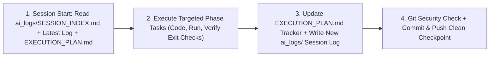
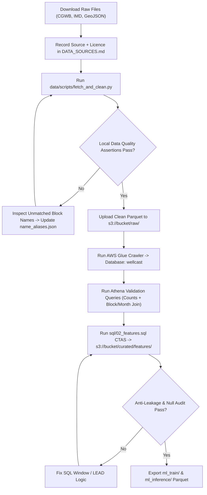
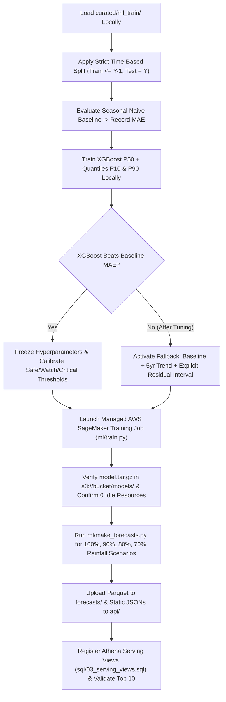
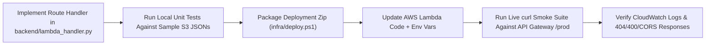
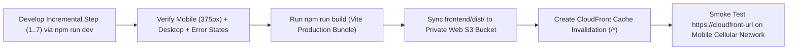

# WellCast: Engineering, Pipeline & AI Collaboration Workflow

This document defines the exact **operational workflows** for developing, testing, deploying, and documenting WellCast across both human teammates and AI coding sessions.

---

## 1. AI Session Continuity Workflow (Mandatory Every Session)

Because WellCast is built across multiple focused sessions over 7 days, **every AI session and developer shift** follows a strict 3-stage loop anchored on `ai_logs/` and `Docs/EXECUTION_PLAN.md`:



### Session Start Checklist
1. Read [`../ai_logs/SESSION_INDEX.md`](../ai_logs/SESSION_INDEX.md) and the **most recent session log** in `ai_logs/`.
2. Check [`EXECUTION_PLAN.md`](./EXECUTION_PLAN.md) §2 (Locked Decisions) and §7 (Master Progress Tracker) to identify the exact Task IDs for this session.
3. Read the relevant technical specification doc before writing any code:
   - Data / SQL -> [`ARCHITECTURE_AND_DATA_SPEC.md`](./ARCHITECTURE_AND_DATA_SPEC.md) & [`../DATA_SOURCES.md`](../DATA_SOURCES.md)
   - ML -> [`ML_SPEC.md`](./ML_SPEC.md)
   - API / UI -> [`API_AND_FRONTEND_SPEC.md`](./API_AND_FRONTEND_SPEC.md)
   - AWS / IAM -> [`AWS_INFRA_AND_SECURITY.md`](./AWS_INFRA_AND_SECURITY.md)

### Session End Checklist
1. Run verification commands for every Task ID touched.
2. If AWS resources were created or jobs run, verify **cost hygiene** (no running SageMaker notebooks/endpoints, budget intact).
3. Create a new log file in `ai_logs/` following `YYYY-MM-DD_session-XX_<short-topic>.md` using [`../ai_logs/TEMPLATE.md`](../ai_logs/TEMPLATE.md).
4. Add a row to [`../ai_logs/SESSION_INDEX.md`](../ai_logs/SESSION_INDEX.md) and update checkboxes in [`EXECUTION_PLAN.md`](./EXECUTION_PLAN.md).
5. Run secret/hygiene checks (`git status`, `git diff`) and commit cleanly.

---

## 2. Git & Branching Workflow

Keep Git history clean, audit-ready for public hackathon judging, and strictly free of secrets or oversized raw data files.

### Branch Strategy
- **`main`**: Always stable, clean, and deployable. Never commit broken builds or temporary debug dumps directly to `main`.
- **Feature branches** (for parallel team work or multi-file changes):
  - `feat/phase1-data-pipeline`
  - `feat/phase2-athena-features`
  - `feat/phase3-ml-sagemaker`
  - `feat/phase5-lambda-api`
  - `feat/phase6-react-frontend`
  - `docs/<topic>`
  - `fix/<issue>`

### Conventional Commit Format
```text
<type>(<scope>): <concise imperative summary>

Types: feat | fix | docs | data | ml | infra | chore | test
Scopes: data, sql, ml, api, ui, infra, docs, logs
```
Examples:
- `data(clean): standardize Maharashtra block names and export raw Parquet`
- `ml(train): add XGBoost quantile P10/P90 models and time-split evaluation`
- `api(lambda): implement forecast and rankings handlers reading S3 static JSON`
- `ui(map): add Leaflet choropleth layer with Safe/Watch/Critical palette`
- `docs(logs): add session-03 log covering Phase 1 S3 and Athena verification`

### Mandatory Pre-Commit Rules
1. **Never commit:** `.env`, `*.pem`, `*.key`, AWS credentials, `data/raw_local/` large dumps (>5 MB), `frontend/node_modules/`, `frontend/dist/`, `__pycache__/`, `.venv/`.
2. **Only commit tiny representative samples** (e.g., 20–50 rows) inside `data/sample/` so judges can inspect schemas locally without bloating the repository.
3. Run a quick secret scan before pushing:
   ```powershell
   git grep -E "(AKIA[0-9A-Z]{16}|aws_secret_access_key|BEGIN PRIVATE KEY)"
   ```
   (Must return zero matches!)

---

## 3. Data Ingestion & Feature Pipeline Workflow (Phases 1–2)



### Standard Commands (Windows PowerShell)
```powershell
# 1. Run cleaning & validation locally
python data/scripts/fetch_and_clean.py --state Maharashtra --out data/processed_local

# 2. Upload Parquet tables to S3 raw/
aws s3 sync data/processed_local/raw/ s3://<BUCKET>/raw/ --delete --profile wellcast

# 3. Trigger Glue Crawler and wait for completion
aws glue start-crawler --name wellcast-raw-crawler --profile wellcast
aws glue get-crawler --name wellcast-raw-crawler --query "Crawler.State" --profile wellcast
```

---

## 4. ML Training, SageMaker & Scenario Generation Workflow (Phases 3–4)



### Key ML Workflow Guardrails
1. **Iterate locally, finalize on SageMaker:** Do all feature experiments and hyperparameter tuning on your laptop (zero AWS cost, seconds per run). Trigger SageMaker once the code passes all local tests.
2. **Never leave SageMaker running:** Use `Estimator.fit(..., wait=True)` (a short-lived training job that terminates automatically in 2–5 minutes). Never call `estimator.deploy()`.
3. **Always run schema validation on `api/` JSONs** before uploading to S3 so broken payloads never hit Lambda or the React UI.

---

## 5. Backend API Development & Deployment Workflow (Phase 5)



### Backend Iteration Rules
- Keep Lambda **stateless and thin**: read precomputed JSON from S3 `api/` and cache in module-level dict with a 5-minute TTL (`CACHE_TTL_SECONDS = 300`).
- Test all 5 routes after every deploy:
  1. `GET /health` -> `200 OK`
  2. `GET /blocks?state=MH` -> `200 OK` (array of blocks)
  3. `GET /blocks/<valid_id>/forecast?scenario=normal` & `?scenario=minus20` -> `200 OK`
  4. `GET /blocks/INVALID-ID/forecast` -> `404 Not Found` (clean JSON error)
  5. `GET /blocks/<valid_id>/history` -> `200 OK`
  6. `GET /rankings?state=MH&limit=20` -> `200 OK`

---

## 6. Frontend Build & CloudFront Deployment Workflow (Phase 6)



### Standard Frontend Deploy Commands (Windows PowerShell)
```powershell
Set-Location frontend
npm run build
aws s3 sync dist/ s3://<WEB_BUCKET>/ --delete --profile wellcast
aws cloudfront create-invalidation --distribution-id <DIST_ID> --paths "/*" --profile wellcast
```

### Cache-Control Best Practice
- Upload `index.html` with `--cache-control "no-cache, no-store, must-revalidate"` so fresh deploys appear immediately.
- Upload hashed static assets (`assets/*`) with `--cache-control "public, max-age=31536000, immutable"`.

---

## 7. QuickSight & Reporting Workflow (Phase 7 — P2 Bonus)

1. Verify QuickSight pricing/trial terms first (`AWS_INFRA_AND_SECURITY.md` §6).
2. Connect QuickSight in `ap-south-1` to Athena database `wellcast` (`forecasts` and `block` tables).
3. Build the 3 planner visuals (Top 20 At-Risk Blocks, District Risk Breakdown, Historical vs Predicted Trend).
4. **Immediately export screenshots and a 30-second video clip** to `Docs/assets/quicksight/` so Demo Day is completely insulated from trial expiration.

---

## 8. Hardening, Freeze & Incident Recovery Workflow (Phases 8–10)

### Pre-Submission Hardening Flow
1. Run full test checklist in [`TESTING_AND_QA_CHECKLIST.md`](./TESTING_AND_QA_CHECKLIST.md).
2. Confirm UI gracefully handles: (a) missing block data, (b) API unreachable, (c) invalid query params.
3. Verify CORS restricts `Access-Control-Allow-Origin` to the exact `https://<dist>.cloudfront.net` origin (plus `http://localhost:5173` only during dev, removed before final freeze).
4. Run AWS Cost & Idle Resource check.

### Post-Submission Freeze Protocol (1 Dec – 5 Dec)
- **Zero infrastructure or production code changes** while Round 1 judges inspect the live URL.
- Perform a daily passive check: open `https://<dist>.cloudfront.net` in incognito + check `GET /health`.
- If a critical outage occurs during judging (e.g., accidental S3 policy change or CloudFront error), fix strictly the broken config, document the incident in `ai_logs/`, and re-verify immediately.

### Emergency Fallback Decision Tree
- **CloudFront distribution stuck deploying (>20 min) right before deadline?** -> Keep waiting for CloudFront (usually 5–15 min); never disable S3 Block Public Access as a hasty shortcut unless absolutely necessary as a documented last resort.
- **API Gateway throttled or Lambda failing during live Demo Day?** -> Switch React app cleanly to bundled static fallback snapshot mode (`?demo_offline=1` feature flag) ONLY if live network fails at the IIT Bombay venue Wi-Fi, while transparently explaining to judges that venue Wi-Fi dropped.
