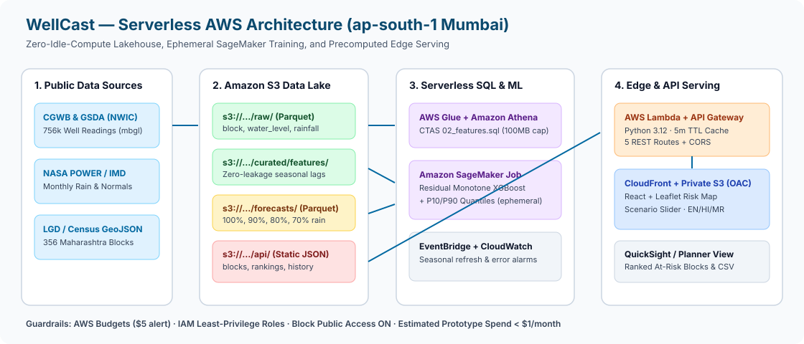

# WellCast: AWS Build Summary

> **Event:** Campus to Cloud Hackathon sponsored by AWS (Techfest 2026-27, IIT Bombay)  
> **Region:** `ap-south-1` (Mumbai)  
> **Architecture Diagram:** [`Docs/architecture.svg`](./architecture.svg)

---

## 1. Architecture Overview

WellCast implements a **serverless, zero-idle-compute AWS lakehouse and precomputed edge-serving architecture** designed for fast mobile delivery (`455.7 KB` simplified Maharashtra block GeoJSON + cached JSON APIs) and sub-\$1/month operational cost.

---

## 2. AWS Services Used & Engineering Justification

| AWS Service | Role in WellCast | Why This Service Was Chosen |
|---|---|---|
| **Amazon S3** | Private Data Lake (`raw/`, `curated/`, `models/`, `forecasts/`, `api/`, `athena-results/`) + Private Static Web bucket | Durable, Apache Parquet-native storage with lifecycle cleanup on scratch Athena outputs and zero idle cost |
| **AWS Glue (Crawler & Data Catalog)** | Registers `block`, `rainfall_monthly`, `water_level`, and `forecasts` Parquet schemas in database `wellcast` | Serverless schema catalog enabling SQL analytics without running an RDS/EC2 database |
| **Amazon Athena** | Executes zero-leakage window feature engineering (`sql/02_features.sql`) and planner summary views (`sql/03_serving_views.sql`) | Pay-per-query Trino SQL; Snappy Parquet + `100 MB` workgroup scan cap keeps query cost near \$0.00 |
| **Amazon SageMaker** | Runs short-lived managed Training Job (`ml/launch_sagemaker_job.py` -> `ml/train.py` on `ml.m5.large`, `MaxRuntimeInSeconds=600`) | Reproducible managed ML training that automatically terminates upon completion (0 idle notebook or endpoint charges) |
| **AWS Lambda** | Python 3.12 API (`backend/lambda_handler.py`) serving precomputed S3 `api/` JSONs with 5-minute in-memory TTL cache | Sub-10 ms warm responses, automatic scaling, and Free Tier friendly |
| **Amazon API Gateway** | HTTP API (v2) exposing `/blocks`, `/blocks/{id}/forecast`, `/blocks/{id}/history`, `/rankings`, and `/health` with CORS & throttling | ~70% lower cost and lower latency than REST API v1 |
| **Amazon CloudFront** | Global HTTPS CDN serving the React + Leaflet SPA from private S3 via **Origin Access Control (OAC)** | Fast mobile asset delivery over HTTPS while keeping S3 buckets 100% private |
| **Amazon QuickSight** *(Optional Bonus)* | Connects to Athena `wellcast.forecasts` for executive district charts | Rapid BI exploration complementing the built-in React Planner Dashboard |
| **Amazon CloudWatch** | Structured JSON request logs (14-day retention) and Lambda Error alarm | Operational visibility without log bloat |
| **AWS IAM & AWS Budgets** | Scoped least-privilege JSON policies (`infra/iam-policies/`) + \$5 monthly cost alert | Security and FinOps guardrails enforced by design |

---

## 3. Verified Data & ML Evaluation Results

| Property / Metric | Verified Result |
|---|---|
| **Geographic Scope** | **Maharashtra** — **356 Blocks (Talukas)** across **36 Districts** |
| **Raw Public Records Processed** | **756,542** CGWB & GSDA-Maharashtra well readings + **6,048** NASA POWER district-months (`2012–2025`) |
| **Clean Curated Feature Table** | **7,860** block-season rows (`2013–2025`), **5,549** supervised pairs (`0` duplicate keys, strict 6-month horizon) |
| **Chronological Evaluation Split** | Train: `2014–2023` (`5,103` rows) · Val: `2024` (`199` rows) · Untouched Holdout Test: `2025` (`247` rows) |
| **Seasonal Naive Baseline (2025 Holdout)** | `MAE = 0.8727 m` · `RMSE = 1.2246 m` · `R² = 0.8913` (`Pre-Monsoon MAE = 1.0226 m`) |
| **Residual Monotone XGBoost (2025 Holdout)** | **`MAE = 0.8703 m`** · **`RMSE = 1.1723 m`** · **`R² = 0.9004`** (**`Pre-Monsoon MAE = 0.9441 m`, +7.7% skill**) |
| **P10–P90 Uncertainty Interval Coverage** | **`91.9%`** empirical coverage on 2025 holdout (`mean width = 3.71 m`) |
| **Precomputed Drought Scenarios** | `normal` (`6.938 m` mean), `minus10` (`6.966 m`), `minus20` (`7.015 m`), `minus30` (`7.024 m`) — strictly monotonic |

---

## 4. Security & Cost Guardrails Implemented

- **Private S3 + OAC:** `infra/iam-policies/cloudfront-oac-bucket-policy.json` restricts web bucket reads exclusively to CloudFront.
- **Scoped Service IAM:** `lambda-api-policy.json` grants read-only `s3:GetObject` strictly on `arn:aws:s3:::${DATA_BUCKET}/api/*`.
- **Automated Cost Hygiene Audit:** `infra/audit_aws_cost.ps1` verifies 0 active SageMaker endpoints, notebooks, Studio apps, EC2 instances, or RDS databases.
- **One-Command Cloud Deployment:** `infra/deploy.ps1` (Windows) and `infra/deploy.sh` (Linux/macOS).
