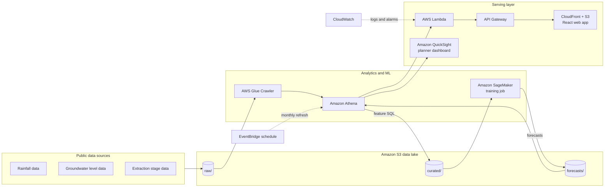
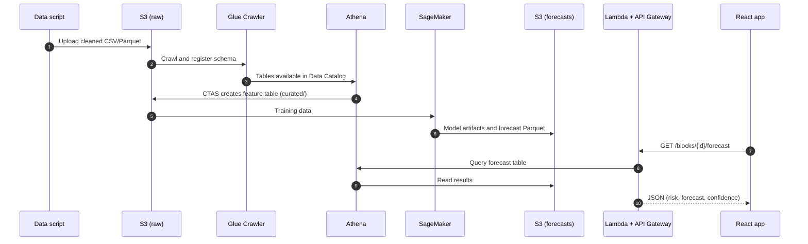
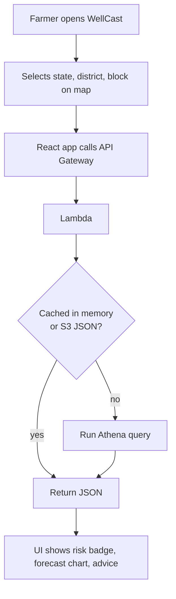
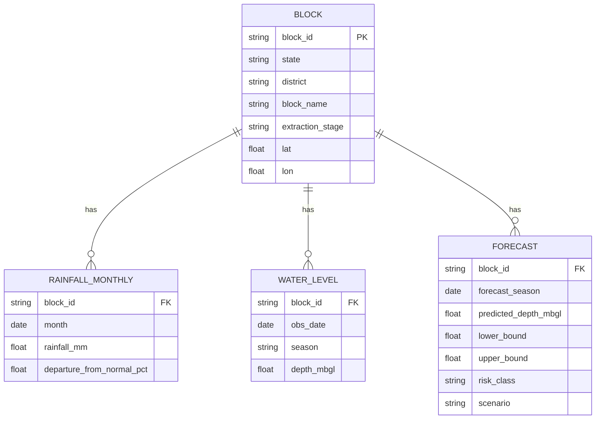

# 💧 WellCast: Groundwater Depletion Forecaster
 
> **See groundwater stress before it hits.**
> Block-level groundwater forecasts for Indian farmers and water planners, built on AWS.
 
Built for the **Campus to Cloud Hackathon sponsored by AWS** (Techfest 2026-27, IIT Bombay).
 
| | |
|---|---|
| **Live prototype** | `https://<your-cloudfront-id>.cloudfront.net` *(replace after deploy)* |
| **Demo video** | `<link>` *(under 3 minutes)* |
| **AWS Builder Center alias** | `<your-alias>` |
| **Team** | `<names>` |
 
---
 
## Table of contents
 
1. [Problem](#1-problem)
2. [Who it helps](#2-who-it-helps)
3. [Solution overview](#3-solution-overview)
4. [Architecture](#4-architecture)
5. [AWS services and why](#5-aws-services-and-why)
6. [Data](#6-data)
7. [ML approach](#7-ml-approach)
8. [API reference](#8-api-reference)
9. [Repository structure](#9-repository-structure)
10. [Implementation plan](#10-implementation-plan)
11. [Setup and deployment](#11-setup-and-deployment)
12. [Cost guardrails](#12-cost-guardrails)
13. [Impact and metrics](#13-impact-and-metrics)
14. [Limitations and honest caveats](#14-limitations-and-honest-caveats)
15. [Roadmap](#15-roadmap)
16. [Hackathon submission checklist](#16-hackathon-submission-checklist)
---
 
## 1. Problem
 
India is the world's largest extractor of groundwater, and a large share of irrigation and drinking water depends on it. The problem is not only that water is depleting, but that **nobody sees it coming at a local level**.
 
- **Farmers** decide what to sow and whether to drill deeper without knowing if the aquifer beneath them will last the season.
- **Block and district planners** rely on periodic assessments that are outdated by the time they are published.
- **The data exists** (rainfall, monitoring-well levels, extraction stage) but is scattered across portals and spreadsheets, and is rarely turned into a *forward-looking*, *local* warning.
## 2. Who it helps
 
| User | What they get |
|---|---|
| Farmers | A simple block-level risk rating (Safe / Watch / Critical), a forecast for the coming season and crop-water advice |
| Block and district planners | A ranked list of blocks most at risk, trends, and scenario analysis for allocating tankers, recharge structures and subsidies |
| NGOs and researchers | Explorable data and downloadable forecasts |
 
## 3. Solution overview
 
WellCast ingests rainfall and groundwater-level data, joins them at **block level**, trains a forecasting model, and serves the predictions through:
 
- a **farmer-facing web app** (map, risk badge, plain-language advice), and
- a **planner dashboard** (ranked blocks, trends, scenarios).
**Key features**
 
- 🗺️ Interactive block-level risk map
- 📈 Next-season water-level forecast with a confidence range
- 🌧️ "What if rainfall is 10–30% below normal?" scenario slider (precomputed scenarios)
- 🌾 Plain-language advice per risk level
- 🌐 English plus regional language toggle (Hindi/Marathi)
- 📊 Planner dashboard with ranked at-risk blocks
---
 
## 4. Architecture
 
### 4.1 High-level architecture
 

 
### 4.2 Data pipeline (sequence)
 

 
### 4.3 Request flow for a farmer
 

 
### 4.4 Data model
 

 
---
 
## 5. AWS services and why
 
| Service | Role in WellCast | Why this choice |
|---|---|---|
| **Amazon S3** | Data lake (`raw/`, `curated/`, `forecasts/`) and static hosting for the web app | Cheap, durable, free-tier friendly |
| **AWS Glue (Crawler)** | Detects schema and registers tables | Lets Athena query files without running a database |
| **Amazon Athena** | Serverless SQL for joins, feature engineering and serving queries | Pay per query, no servers to keep alive |
| **Amazon SageMaker** | Trains the forecasting model in a short-lived training job | Managed training; no idle cost when the job ends |
| **Amazon QuickSight** | Planner dashboard (ranked blocks, trends, maps) | Fast BI without custom front-end work |
| **AWS Lambda + API Gateway** | Thin JSON API that queries Athena or reads precomputed JSON | Serverless, near-zero idle cost |
| **Amazon CloudFront** | HTTPS global delivery of the React app | Fast, free-tier friendly, stable public URL |
| **Amazon EventBridge** | Monthly scheduled refresh | Automates re-ingestion and re-forecasting |
| **Amazon CloudWatch** | Logs, metrics, alarms | Visibility into Lambda and pipeline failures |
| **AWS IAM** | Least-privilege roles per component | Security baseline |
 
---
 
## 6. Data
 
> ⚠️ **Verify availability and licence terms of every dataset before use, and cite each one in the final submission.**
 
| Dataset | Typical source | Use |
|---|---|---|
| Groundwater level (monitoring wells, pre- and post-monsoon) | CGWB / India-WRIS | Target variable |
| Rainfall (monthly, district or gridded) | IMD / data.gov.in | Main predictor |
| Block extraction stage (Safe / Semi-critical / Critical / Over-exploited) | CGWB assessment reports | Context feature and label cross-check |
| Block boundaries (GeoJSON) | Public administrative boundary datasets | Map rendering |
 
**Scope for the prototype:** start with **one state** (for example Maharashtra), then show a clear path to national coverage.
 
**Rules we follow**
 
- No fabricated data. Where data is missing, we say so in the UI.
- Interpolated or imputed values are flagged.
- Every dataset is credited in `DATA_SOURCES.md`.
---
 
## 7. ML approach
 
**Goal:** predict next-season groundwater depth (metres below ground level) per block and derive a risk class.
 
**Features**
 
- Rolling 3- and 6-month rainfall totals
- Rainfall departure from the long-term normal
- Previous season's water-level change
- Current depth and 5-year trend
- Extraction stage (encoded)
- Season (pre-monsoon / post-monsoon)
**Models**
 
| Stage | Model | Reason |
|---|---|---|
| Baseline | Seasonal naive (last year's same season) | A sanity benchmark to beat |
| Main | XGBoost regressor (SageMaker built-in or script mode) | Strong on small tabular data, fast to train |
| Uncertainty | Quantile regression (10th / 90th percentile) | Shows a confidence range, not one number |
 
**Risk classes** (thresholds to be calibrated on the chosen state)
 
| Class | Meaning |
|---|---|
| 🟢 Safe | Stable or recovering water level |
| 🟡 Watch | Falling beyond a set rate or nearing a critical depth |
| 🔴 Critical | Rapid decline or very deep and still falling |
 
**Evaluation:** time-based split (train on earlier years, test on the latest). Report MAE against the baseline. Never use random splits for time-series data.
 
**Scenarios:** run the model with rainfall set to 100%, 90%, 80% and 70% of normal and store all results, so the UI slider is instant and costs nothing at runtime.
 
---
 
## 8. API reference
 
Base URL: `https://<api-id>.execute-api.ap-south-1.amazonaws.com/prod`
 
| Method | Path | Description |
|---|---|---|
| `GET` | `/blocks?state=&district=` | List blocks with current risk class |
| `GET` | `/blocks/{block_id}/forecast?scenario=normal` | Forecast, confidence range and risk class |
| `GET` | `/blocks/{block_id}/history` | Historical water level and rainfall |
| `GET` | `/rankings?state=&limit=20` | Top at-risk blocks (planner view) |
| `GET` | `/health` | Health check |
 
**Example response**
 
```json
{
  "block_id": "MH-PUN-012",
  "block_name": "Example Block",
  "scenario": "normal",
  "forecast_season": "2027-pre-monsoon",
  "predicted_depth_mbgl": 14.2,
  "lower_bound": 12.9,
  "upper_bound": 15.6,
  "risk_class": "Watch",
  "advice": "Prefer low-water crops and plan recharge before the dry season."
}
```
 
---
 
## 9. Repository structure
 
```
wellcast/
├── README.md
├── DATA_SOURCES.md
├── LICENSE
├── docs/
│   ├── architecture.png
│   ├── idea-brief.md
│   └── build-summary.md
├── data/
│   ├── sample/                  # small sample files only
│   └── scripts/
│       ├── fetch_and_clean.py
│       └── upload_to_s3.sh
├── sql/
│   ├── 01_create_tables.sql
│   ├── 02_features.sql
│   └── 03_serving_views.sql
├── ml/
│   ├── train.py                 # SageMaker script-mode entry point
│   ├── evaluate.py
│   ├── make_forecasts.py
│   └── requirements.txt
├── backend/
│   ├── lambda_handler.py
│   ├── athena_client.py
│   └── requirements.txt
├── frontend/
│   ├── package.json
│   ├── public/
│   └── src/
│       ├── components/          # Map, RiskBadge, ForecastChart, ScenarioSlider
│       ├── i18n/                # en.json, hi.json, mr.json
│       └── App.jsx
└── infra/
    ├── iam-policies/
    └── deploy.sh
```
 
---

## 10. Implementation plan

Full operational planning and engineering specifications live in [`Docs/`](./Docs/README.md) and [`ai_logs/`](./ai_logs/SESSION_INDEX.md):

- [`Docs/IMPLEMENTATION_PLAN.md`](./Docs/IMPLEMENTATION_PLAN.md) — 10-phase end-to-end hackathon roadmap and fallback gates
- [`Docs/EXECUTION_PLAN.md`](./Docs/EXECUTION_PLAN.md) — 44-task operational runbook (`T0.1`–`T10.4`), decision register, and tracker
- [`Docs/WORKFLOW.md`](./Docs/WORKFLOW.md) — Git, AI session, Data, ML, API, and CloudFront workflows
- [`Docs/ARCHITECTURE_AND_DATA_SPEC.md`](./Docs/ARCHITECTURE_AND_DATA_SPEC.md) — S3 lake layout, schemas, and zero-leakage Athena SQL
- [`Docs/ML_SPEC.md`](./Docs/ML_SPEC.md) — Residual Monotone XGBoost, P10/P90 quantiles, risk calibration, and scenarios
- [`Docs/API_AND_FRONTEND_SPEC.md`](./Docs/API_AND_FRONTEND_SPEC.md) — REST contracts, 7-step React/Leaflet UI spec, and EN/HI/MR localization
- [`Docs/AWS_INFRA_AND_SECURITY.md`](./Docs/AWS_INFRA_AND_SECURITY.md) — Least-privilege IAM JSON policies, Budgets, and CloudFront OAC
- [`Docs/TESTING_AND_QA_CHECKLIST.md`](./Docs/TESTING_AND_QA_CHECKLIST.md) — 5-layer test suite, demo video script, and Judge Q&A guide

---

## 11. Setup and deployment

### Local end-to-end execution

```powershell
# 1. Create virtual environment and install dependencies
python -m venv .venv
.\.venv\Scripts\python.exe -m pip install -r ml/requirements.txt pytest

# 2. Run data cleaning, SQL feature engineering, ML training, and 4-scenario JSON export
.\.venv\Scripts\python.exe data/scripts/fetch_and_clean.py
.\.venv\Scripts\python.exe data/scripts/build_features_local.py
.\.venv\Scripts\python.exe ml/train.py
.\.venv\Scripts\python.exe ml/make_forecasts.py

# 3. Run unit & end-to-end verification suite
.\.venv\Scripts\python.exe -m pytest -v

# 4. Start local Lambda API server (Terminal 1) and React Vite app (Terminal 2)
.\.venv\Scripts\python.exe backend/local_server.py --port 8000
cd frontend && npm install && npm run dev
```

### AWS deployment (`ap-south-1` Mumbai)

1. Configure your non-root IAM CLI profile (`aws configure --profile wellcast`) and set a \$5 AWS Budgets alert (see [`Docs/AWS_INFRA_AND_SECURITY.md`](./Docs/AWS_INFRA_AND_SECURITY.md)).
2. Create private S3 buckets (`FORECAST_BUCKET` and `WEB_BUCKET`), Glue database `wellcast`, Athena workgroup `wellcast-wg` (`100 MB` scan cap), Lambda `wellcast-api`, HTTP API Gateway `/prod`, and CloudFront OAC distribution.
3. Run a managed short-lived SageMaker training job (`ml/launch_sagemaker_job.py`) and deploy all assets in one command:
   ```powershell
   .\infra\deploy.ps1 -ForecastBucket <data-bucket> -WebBucket <web-bucket> -CloudFrontDistId <dist-id>
   .\infra\audit_aws_cost.ps1 -DataBucket <data-bucket> -WebBucket <web-bucket>
   ```

---

## 12. Cost guardrails

- **AWS Budgets** alert configured before any cloud resource creation
- **Short-lived SageMaker Training Jobs** (`MaxRuntimeInSeconds=600` on `ml.m5.large`) — zero persistent notebooks or hosted endpoints
- **Precomputed static S3 JSON** for all 4 rainfall scenarios (`100%`, `90%`, `80%`, `70%`) plus 5-minute Lambda memory cache
- **Snappy Parquet** storage + Athena workgroup `100 MB` per-query scan limit + 7-day S3 lifecycle rule on `athena-results/`
- **Estimated monthly run cost:** **< \$1.00 USD** at single-state prototype scale

---

## 13. Impact and metrics

Verified results on **Maharashtra (`356` blocks across `36` districts)**:

| Metric | Result |
|---|---|
| Raw monitoring-well records processed (CGWB + GSDA via NWIC) | `756,542` readings (`94,371` valid `2013–2025` seasonal readings) |
| Clean leak-free block-season feature rows | `7,860` rows (`5,549` supervised pairs; `100%` block match rate) |
| Chronological split | Train `2014–2023` · Validation `2024` · Untouched Holdout Test `2025` |
| Seasonal Naive baseline (2025 holdout) | `MAE = 0.8727 m` · `RMSE = 1.2246 m` · `R² = 0.8913` (`Pre-Monsoon MAE = 1.0226 m`) |
| **Dual-Specialist Monotone XGBoost v2 (2025 holdout)** | **`MAE = 0.8147 m` (+6.65% skill)** · **`RMSE = 1.1078 m` (+9.54% skill)** · **`R² = 0.9110`** (**`Pre-Monsoon MAE = 0.8881 m`, +13.15% skill**) |
| **CQR P10–P90 interval coverage** | **`76.92%`** on untouched 2025 holdout (`mean width = 2.62 m`, see [`Docs/MODEL_TRAINING_REPORT.md`](./Docs/MODEL_TRAINING_REPORT.md)) |
| Simplified block boundary GeoJSON | `455.7 KB` (`356` polygons for fast mobile 4G loading) |

---

## 14. Limitations and honest caveats

- **Zero fabricated data:** Blocks with fewer than 4 historical seasonal observations are explicitly labelled `Insufficient Data` rather than imputed with synthetic numbers.
- **Spatial resolution:** Block water levels represent the median of public CGWB/GSDA monitoring wells within each taluka; individual borewells can vary due to fractured Deccan basalt geology and local pumping. Monthly precipitation is derived from district-level NASA POWER agroclimatology grids (`2012–2025`).
- **Decision support:** Forecasts complement — and do not replace — local hydrogeological surveys or official GSDA/CGWB advisories.

---

## 15. Roadmap

1. **Multi-state onboarding:** Extend the state-agnostic `<STATE2>-<DIST3>-<SEQ3>` pipeline to Gujarat, Rajasthan, Karnataka, Punjab, and Telangana via NWIC feeds.
2. **Higher-resolution gridded & telemetry fusion:** Incorporate IMD `0.25°` gridded daily rainfall and NWIC 6-hourly DWLR telemetry stations where station density permits.
3. **Automated seasonal refresh:** Activate EventBridge scheduled seasonal re-ingestion and notifications for district water officers ahead of pre-monsoon sowing.

---

## 16. Hackathon submission checklist

- [x] Verified public datasets cited with licences in [`DATA_SOURCES.md`](./DATA_SOURCES.md)
- [x] Leak-free SQL feature pipeline (`sql/01`–`03`) and chronological holdout evaluation (`ml/train.py`, `ml/evaluate.py`)
- [x] Precomputed 100% / 90% / 80% / 70% rainfall scenarios and multilingual advice (English, Hindi, Marathi)
- [x] Serverless Lambda API (`backend/lambda_handler.py`) + React & Leaflet web app (`frontend/`) + Planner CSV export
- [x] Least-privilege IAM policies (`infra/iam-policies/`), deploy scripts (`infra/deploy.ps1`), and Idea Brief / Build Summary (`Docs/`)
- [ ] Deploy live CloudFront URL, record `< 3 min` demo video, and submit on Techfest portal (target: 29 Nov evening)
